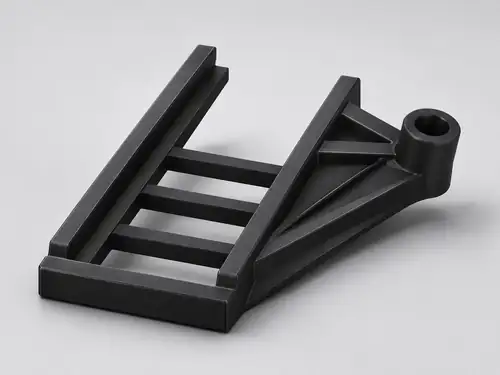

# EasyScanner Evolution

**Scanner 3D à laser linéaire sur smartphone Android — projet documenté en français.**

Cette application utilise la caméra du téléphone, un **laser projetant une ligne** et une **mire ChArUco imprimée** pour reconstituer un nuage de points 3D. Les coordonnées sont exprimées en millimètres, dans un repère local lié à la mire.

> **Projet expérimental** : ce n'est pas un instrument de topographie certifié. La précision des scans réels n'a pas été caractérisée de manière générale. Ne pas utiliser les mesures sans vérification indépendante.

## Bienvenue — les trois liens utiles

| Je veux... | Ouvrir |
|---|---|
| **Comprendre ce que font les fichiers** | **[Guide en français : comprendre les dossiers et les fichiers](docs/COMPRENDRE_LES_FICHIERS.md)** |
| **Installer la dernière version Android Evolution** | **[Compilations APK sur GitHub](https://github.com/vauthierced-pixel/EasyScanner-Evolution/actions/workflows/android-apk.yml)** |
| **Voir le code que nous modifions** | **[Branche Evolution](https://github.com/vauthierced-pixel/EasyScanner-Evolution/tree/evolution-v0.3-fr-apk)** |

**Attention aux branches :** `main` (celle affichée par défaut) conserve le code du projet d'origine et cette documentation française. Nos améliorations Android sont actuellement sur la branche **`evolution-v0.3-fr-apk`**, dans [la proposition de modification n° 1](https://github.com/vauthierced-pixel/EasyScanner-Evolution/pull/1). Ne te fie donc pas uniquement à la liste des fichiers de `main` pour rechercher les nouveautés.

[English original documentation / Documentation originale en anglais](README_EN.md)

## Ce qui fonctionne déjà dans notre version Evolution

- Application Android installable séparément de l'EasyScanner d'origine.
- Parcours principal et galerie des scans traduits en français.
- Reconnaissance de mire ChArUco, calibration caméra et laser, numérisation et visualisation du nuage : fonctions héritées du projet d'origine.
- Enregistrement du nuage de points au format **PLY**.
- **Export DAO XYZ / CSV** directement depuis un scan, en millimètres.
- Option de réduction à **un point par cellule de 1 mm** (sans modifier le PLY source).
- Compilation automatique de l'**APK** par GitHub Actions et tests du convertisseur.

Les derniers exports XYZ/CSV se trouvent dans `Téléchargements/EasyScanner/DAO/` sur le téléphone. Les coordonnées sont locales : **pas de géoréférencement automatique**, et la réduction par grille ne supprime pas spécifiquement les points isolés.

## Où sont les fichiers ?

| Dossier | Explication |
|---|---|
| [`android/`](android/) | L'application du téléphone : Kotlin (interface) et Rust (calculs 3D) |
| [`cad/`](cad/) | Pièces mécaniques et supports à imprimer en 3D |
| [`cad/assembly/`](cad/assembly/) | Assemblage complet du scanner : STEP, FreeCAD et GLB |
| [`charuco/boards/`](charuco/boards/) | Mires ChArUco à imprimer en A4, A3, A2, A1 ou A0 |
| [`docs/images/`](docs/images/) | Images de montage et illustrations |
| [`docs/COMPRENDRE_LES_FICHIERS.md`](docs/COMPRENDRE_LES_FICHIERS.md) | **Explications détaillées, fichier par fichier, en français** |

Les noms techniques restent en anglais (`CameraController.kt`, `cloud.rs`, `build.gradle.kts`, etc.), car le programme en dépend. Ils sont traduits et expliqués dans le guide.

## Prototype : support monobloc renforcé Redmi Note 14 Pro

*Rendu visuel de présentation, et non photographie d'une pièce imprimée. La retenue du téléphone, le dégagement du bloc photo et la rigidité mécanique nécessitent encore une validation.*

Nous étudions un support imprimé **en une seule pièce**, avec glissières pour le téléphone, traverses de rigidification et logement intégré pour un laser linéaire Ø12 mm, sans profilé métallique.

**[Voir les modèles 4G/5G, les STL/STEP et la documentation française](https://github.com/vauthierced-pixel/EasyScanner-Evolution/blob/prototype-support-monobloc/cad/SUPPORT_MONOBLOC_EVOLUTION.md)**.

## Matériel nécessaire pour un scan 3D

- Smartphone Android compatible, Android 10 ou plus récent, processeur ARM64.
- **Module laser linéaire**, idéalement avec boîtier de **12 mm** pour le support fourni, et classe de sécurité clairement identifiée.
- Profilé aluminium en U **16 × 13 × 1,5 mm**, longueur approximative **120 mm**.
- Vis M5 × 25 et taraud M5 pour la rotule.
- Pièces mécaniques imprimées à partir des fichiers [`cad/`](cad/).
- Mire ChArUco imprimée à taille réelle et fixée bien à plat.

Ne jamais viser les yeux avec le laser, ni diriger le faisceau vers une surface réfléchissante. Éviter les modules puissants non classés ou dont l'étiquetage de sécurité n'est pas fiable.

## Première étape : imprimer la mire

Les mires sont ici : [`charuco/boards/`](charuco/boards/).

| Papier | Fichier | Dimensions de la grille | Taille des carrés |
|---|---|---|---|
| **A4** | [Télécharger la mire A4](charuco/boards/charuco_A4_4x6_45mm.pdf) | 4 × 6 | 45 mm |
| **A3** | [Télécharger la mire A3](charuco/boards/charuco_A3_6x8_45mm.pdf) | 6 × 8 | 45 mm |
| A2 | [Mire A2](charuco/boards/charuco_A2_8x10_45mm.pdf) | 8 × 10 | 45 mm |

Imprimer à **100 % / taille réelle**, sans « ajuster à la page ». Vérifier la barre de contrôle de 100 mm avec une règle. Le dictionnaire des mires fournies est `DICT_5X5_100`, identifiant **5**.

Sans laser, tu peux déjà essayer la détection de la mire et la calibration de la caméra. Pour reconstruire la forme d'un objet, il faut ensuite le **laser linéaire fixé rigidement au téléphone**.

## Comment télécharger et installer l'APK

1. Ouvrir **[Actions — Android APK (Evolution)](https://github.com/vauthierced-pixel/EasyScanner-Evolution/actions/workflows/android-apk.yml)**.
2. Choisir une compilation terminée avec une **coche verte**.
3. Descendre jusqu'à **Artifacts** et télécharger **EasyScanner-Evolution-APK**.
4. Décompresser l'archive ZIP : elle contient `app-debug.apk`.
5. Ouvrir cet APK sur le smartphone pour installer la version de test.

Les archives de compilation ne sont pas conservées indéfiniment (30 jours prévus par le workflow). Il peut être nécessaire de se connecter à GitHub pour les télécharger.

## Comprendre les mots techniques

- **APK** : fichier d'installation Android.
- **PLY** : format de nuage de points 3D, pouvant contenir les couleurs.
- **XYZ / CSV** : tableaux de points utilisables pour des traitements DAO.
- **Kotlin** : langage de programmation de l'interface Android.
- **Rust** : langage du moteur de calcul géométrique.
- **ChArUco** : mire à carrés et marqueurs utilisée pour repérer la caméra.
- **GitHub Actions** : service qui compile et teste l'application automatiquement.
- **Fork** : notre copie indépendante du projet d'origine.
- **Branche** : version de travail séparée, où l'on peut modifier le programme sans toucher à l'autre.

Pour aller plus loin : **[le guide complet en français](docs/COMPRENDRE_LES_FICHIERS.md)**.

## Origine du projet et licences

EasyScanner Evolution est un projet dérivé de **[Raw Mechatronics — EasyScanner](https://github.com/RawMechatronicsOrg/EasyScanner)**. Le projet initial est à l'origine de l'application, du moteur Rust, de la conception mécanique et des mires. Nous conservons [la documentation initiale en anglais](README_EN.md).

| Éléments | Licence |
|---|---|
| Code source et scripts | [Apache-2.0](LICENSE) |
| Conception des pièces mécaniques (hors support de téléphone) | [CERN-OHL-S-2.0](cad/LICENSE) |
| Support de téléphone et dérivés concernés | [CC BY-NC-SA 4.0](cad/phone-clamp/LICENSE) |

Le dépôt est public : n'y dépose pas de documents de travail confidentiels ni de données personnelles.

---

**Version française de découverte et de développement.** Les fonctions de numérisation et les mesures devront être évaluées sur des scans réels avant tout usage technique exigeant.
