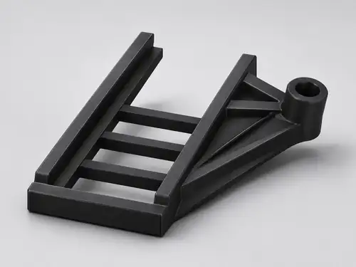

# EasyScanner Evolution — support monobloc sans profilé métallique

## Nouveau : version renforcée pour Redmi Note 14 Pro (4G et 5G)



*Rendu illustratif enregistré dans le dépôt GitHub ; la pièce imprimée et son maintien mécanique restent à tester.*


Le premier cadre générique paraissait trop léger pour maintenir rigidement la géométrie laser/caméra. Une **deuxième conception**, entièrement indépendante du modèle initial, est disponible ici :

**[Source CadQuery renforcée pour Redmi Note 14 Pro](models/support_monobloc_redmi_note14pro_renforce.py)**.

La géométrie générique précédente reste inchangée pour comparaison et retour arrière.

### Renforcements apportés

| Élément | Version initiale | Version renforcée |
|---|---:|---:|
| Paroi latérale des glissières | 3,8 mm | **6 mm** |
| Semelle arrière des rails | 3,4 mm | **5,6 mm** |
| Traverses arrière intermédiaires | 1 | **3** |
| Nervures des bras laser | 6,2 mm de haut | **jusqu'à 14,2 mm** |
| Plateforme triangulée reliant le laser au cadre | bras seulement | **plaque de 6,2 mm et trois nervures** |
| Épaisseur de la bague autour du laser | 3,7 mm | **4,8 mm** |
| Volume de matériau CAO (4G, sans coque) | ~47,7 cm³ (ancien format générique) | **114,9 cm³** |

L'augmentation de matière et des sections **vise** à réduire la flexion. Elle ne prouve pas à elle seule une rigidité suffisante : aucun essai de charge, mesure de déformation ou validation d'impression n'a été effectué.

### Dimensions Xiaomi officielles, hors coque

| Modèle | Largeur | Hauteur | Épaisseur |
|---|---:|---:|---:|
| Redmi Note 14 Pro 4G | 74,92 mm | 162,16 mm | 8,24 mm |
| Redmi Note 14 Pro 5G | 74,42 mm | 162,33 mm | 8,40 mm |

Références constructeur : [Xiaomi Redmi Note 14 Pro 4G](https://www.mi.com/global/product/redmi-note-14-pro/specs/) et [Xiaomi Redmi Note 14 Pro 5G](https://www.mi.com/fr/product/redmi-note-14-pro-5g/specs/).

Les modèles CAO tiennent compte d'un jeu d'insertion de 0,75 mm par côté, mais **ne comprennent pas de surcote de coque** par défaut. La profondeur du bloc photo, l'emplacement exact des boutons et la position de l'objectif utilisé par le scanner sont encore à mesurer et vérifier.

### Génération des fichiers

Notre [action GitHub « Support monobloc — fichiers 3D »](https://github.com/vauthierced-pixel/EasyScanner-Evolution/actions/workflows/support-monobloc.yml) produit maintenant trois conceptions : le prototype générique initial et les deux versions renforcées **4G/5G**, chacune en **STL** et **STEP**. Après exécution réussie, l'archive de téléchargement s'appelle `EasyScanner-Supports-Monobloc-Redmi-4G-5G-STL-STEP`.

Exemples sur PC :

```bash
python cad/models/support_monobloc_redmi_note14pro_renforce.py --modele 4g --sortie sortie/
python cad/models/support_monobloc_redmi_note14pro_renforce.py --modele 5g --sortie sortie/
```

**Coque :** mesurer sa surépaisseur totale, puis utiliser les options `--coque-largeur`, `--coque-longueur` et `--coque-epaisseur`. Ne pas imprimer en supposant que la taille du téléphone sans coque suffira.

**Sécurité :** le cadre reste ouvert en haut, sans verrouillage anti-extraction. **Ne pas monter le vrai téléphone pour un essai en mouvement** : d'abord tester un gabarit, puis prévoir une retenue supérieure intégrée. Le clip laser et les rails doivent être ajustés au matériel réel.

---

**Prototype de conception paramétrique**, préparé pour étudier un support du téléphone et du laser **imprimé en une seule pièce**.

Ce modèle ne reprend pas la forme du support de téléphone tiers d'origine : il s'agit d'un cadre neuf, avec deux glissières latérales, une butée basse, une traverse arrière et deux bras rigides portant un clip de laser intégré.

## Ce qu'il remplace

Dans le montage d'origine, le téléphone et le laser sont tenus par des supports séparés sur un **profilé aluminium en U 16 × 13 mm**. Ce prototype supprime le profilé et les assemblages mécaniques intermédiaires. **Le téléphone et le module laser restent évidemment des composants à insérer dans la pièce.**

Il n'est **pas encore validé pour maintenir un véritable téléphone en mouvement** : les glissières sont ouvertes en haut et il manque un verrouillage positif pour éviter la sortie accidentelle du téléphone. Avant tout essai sur appareil réel, ajouter une retenue fiable, vérifier la protection des surfaces et tester avec un gabarit factice.

## Fonctionnement du modèle

- Téléphone glissé dans deux rails en C, **écran vers le haut** et **caméra arrière vers le bas**.
- Cadre largement ouvert sur la face arrière du téléphone afin de dégager les objectifs. La position exacte des caméras doit être vérifiée.
- Butée en partie basse, traverse de rigidification dans la moitié basse.
- Deux bras imprimés forment un triangle vers le support laser, fixé **à droite** du téléphone.
- Clip fendu pour recevoir un **laser linéaire cylindrique Ø12 mm**.
- Axe du laser incliné de **15° vers le centre de la zone filmée**. L'orientation de la ligne projetée se règle en faisant tourner le module dans le logement ; son inclinaison n'est pas réglable mécaniquement après impression.

## Valeurs provisoires — prototype, pas les dimensions réelles de ton téléphone

| Paramètre | Valeur d'essai |
|---|---:|
| Largeur téléphone, coque comprise | 76 mm |
| Longueur téléphone | 160 mm |
| Épaisseur téléphone, coque comprise | 10 mm |
| Diamètre nominal du laser | 12 mm |
| Inclinaison laser | 15° |
| Décalage du laser depuis l'extérieur du cadre | 42 mm |
| Encombrement extérieur calculé | 142,9 × 156,5 × 32,6 mm |
| Volume de matière calculé | environ 47,7 cm³ |

Les dimensions finales dépendent du modèle du téléphone, de la coque et du laser choisi. La tenue du clip Ø12 mm et les tolérances d'impression doivent être vérifiées sur une petite éprouvette avant impression complète.

## Fichiers et téléchargement

- **[Source CadQuery paramétrique : support_monobloc_evolution.py](models/support_monobloc_evolution.py)** — le modèle éditable et ses réglages.
- **[GitHub Actions : générer le STL et le STEP](../../actions/workflows/support-monobloc.yml)** — procédure de compilation CAO, accessible dans l'onglet **Actions**.
- Après une exécution réussie, télécharger l'archive **`EasyScanner-Support-Monobloc-STL-STEP`** dans **Artifacts**. Elle contient les deux formats.

Le **STL** sert à préparer une impression 3D ; le **STEP** peut être ouvert dans FreeCAD ou un logiciel de CAO compatible pour modifier le support. Les fichiers sont générés par le même script.

## Régénérer le support sur un PC

Il faut Python et [CadQuery](https://cadquery.readthedocs.io/).

```bash
python -m pip install cadquery
python cad/models/support_monobloc_evolution.py --sortie sortie/
```

Exemple pour un téléphone de 73 × 158 × 9 mm (avec sa coque), avec laser Ø12 mm :

```bash
python cad/models/support_monobloc_evolution.py --largeur 73 --longueur 158 --epaisseur 9 --laser 12 --inclinaison 15 --sortie sortie/
```

## Impression 3D : premières hypothèses

- Poser la face inférieure du cadre sur le plateau (le fichier STL est déjà orienté ainsi).
- Privilégier **PETG** pour la résistance aux petites flexions des lèvres des glissières et du clip. Le PLA peut servir pour vérifier les dimensions sur un gabarit.
- Départ d'essai : buse 0,4 mm, couches 0,2 mm, 4 périmètres, remplissage 25 à 35 %, bordure d'adhérence si nécessaire.
- Le clip laser incliné et les lèvres des rails peuvent présenter des surplombs : **vérifier l'aperçu du trancheur et ajouter des supports seulement si nécessaire**.
- Ne pas forcer un module laser dans le clip et ne pas insérer un téléphone sans avoir contrôlé les dimensions et le maintien.
- Ne pas laisser un téléphone suspendu au-dessus d'une surface dure avec ce prototype non verrouillé.

Ces recommandations sont indicatives : **aucune impression ni essai mécanique réel n'a encore été effectué**. Un STL valide ne prouve ni la résistance ni l'absence de déformation à l'impression.

## Ce qu'il reste à concevoir pour la version définitive

1. Adapter précisément les glissières aux dimensions du téléphone **avec ou sans coque**.
2. Dégager la zone des caméras, des boutons et de la prise de charge.
3. Créer une **retenue supérieure intégrée** qui empêche le téléphone de glisser.
4. Adapter le diamètre et le centrage au module laser acheté, avec un angle cohérent pour la distance de travail.
5. Vérifier la rigidité, le sens d'impression et les jeux sur des prototypes.

**Priorité actuelle :** vérifier la forme et les dimensions avant de prétendre à un support opérationnel.

## Licence

Le script et la géométrie nouvelle sont déposés dans `cad/`, sous la licence [CERN-OHL-S-2.0](../LICENSE), comme les autres modèles mécaniques de la collection, hors exceptions explicites.

Pour le scanner d'origine et sa conception : [Raw Mechatronics — EasyScanner](https://github.com/RawMechatronicsOrg/EasyScanner).
